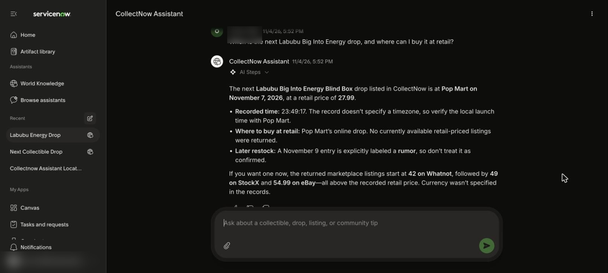
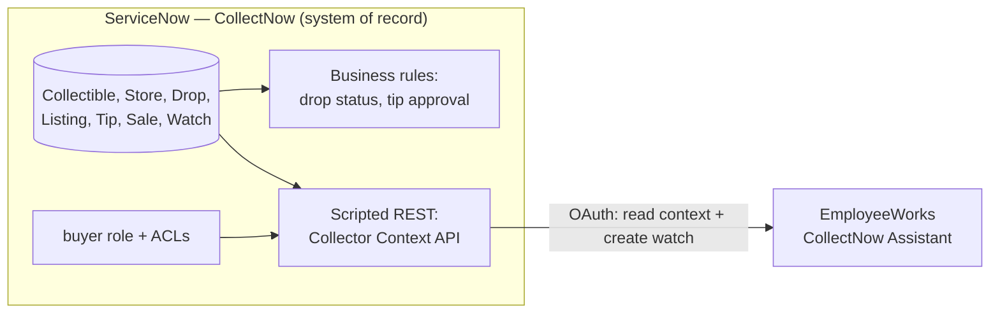
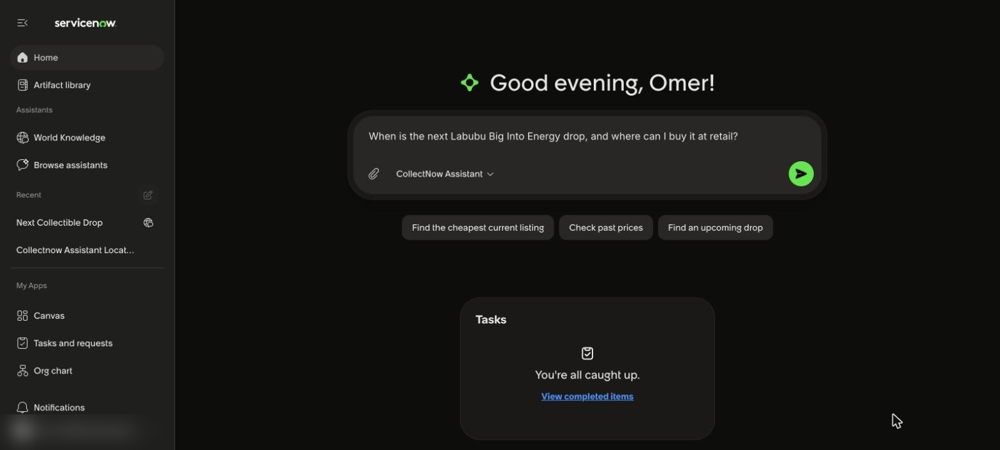
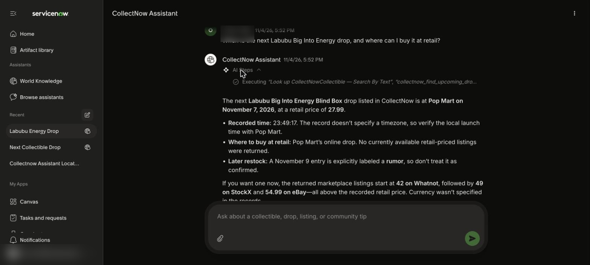
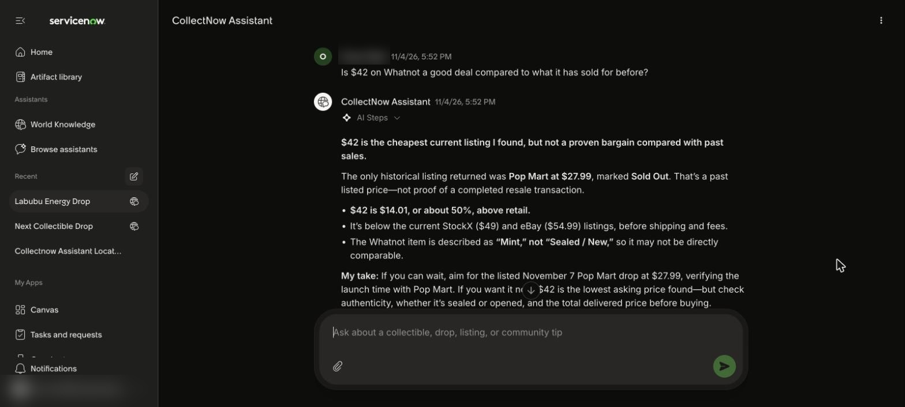
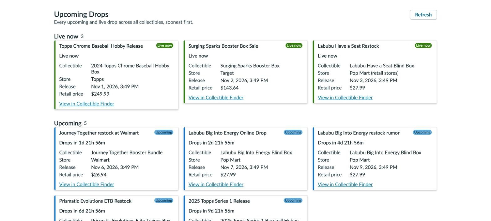
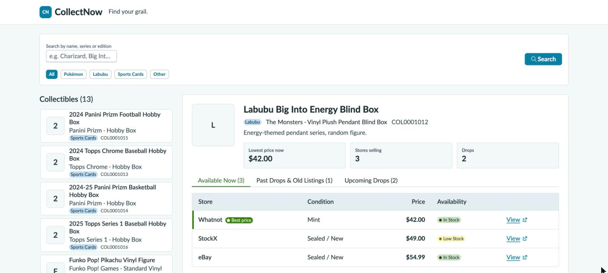
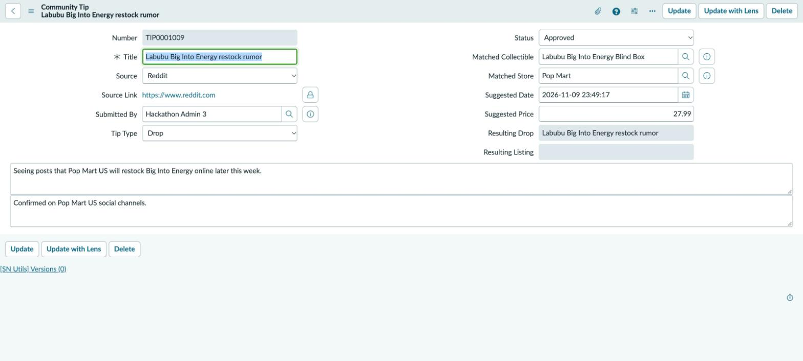
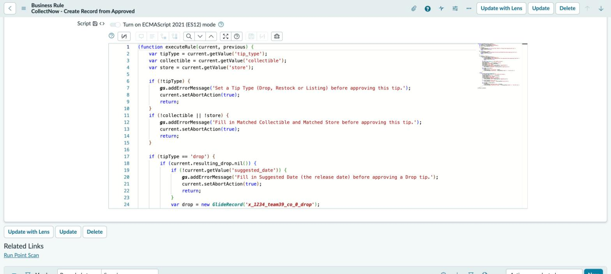
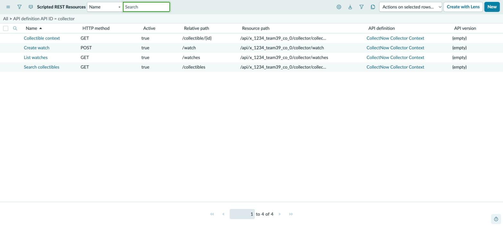

# CollectNow

**Scattered rumors → verified drops and fair prices.**
A ServiceNow scoped app plus an EmployeeWorks assistant. Collectors use it to find out when the next drop is, where to buy at retail, and whether a resale price is fair. Built by Team39 at the **now[dev]26 hackathon**.

▶️ **Demo video (2:05):** [`docs/demo/collectnow-demo.mp4`](docs/demo/collectnow-demo.mp4) · 📄 **[Executive summary](docs/EXECUTIVE_SUMMARY.md)** · 🧭 **[Architecture & design intent](docs/ARCHITECTURE.md)**



---

## The problem

Collectors chase items like a Labubu blind box, a Pokémon Elite Trainer Box or a sports-card hobby box. The information they need is scattered:

- **Group chats and forums** pass around restock rumors with conflicting dates.
- **Official stores** sell out with no restock date.
- **Resellers** charge up to roughly 2× retail (in our demo data, $54.99 against $27.99).

## The solution

CollectNow is a **three-layer build**: **EmployeeWorks** as the AI front door, **ToolSmith** plugins in Moveworks Tool Studio as the middle layer, and a **ServiceNow** app as the system of record. Why it's shaped this way, and what we learned: **[docs/ARCHITECTURE.md](docs/ARCHITECTURE.md)**.


| Layer | What it does |
|---|---|
| **EmployeeWorks · CollectNow Assistant** | Collectors ask in plain language ("When is the next Big Into Energy drop, and where can I buy it at retail?"). The assistant calls ServiceNow live and answers with drops, prices, and a deal check. |
| **ServiceNow · CollectNow app** | The system of record for collectibles, stores, drops, listings, community tips, previous sales and watches. Business rules turn verified community tips into drops automatically. A role-secured Collector Context API serves EmployeeWorks over OAuth. |



## Screenshots

| | |
|---|---|
|  Maya asks in EmployeeWorks |  Live lookups against CollectNow |
|  "Is $42 a good deal?" |  Upcoming Drops page with countdowns |
|  Collectible Finder, best price flagged |  A Reddit tip, verified and turned into a drop |
|  Guard rails on tip approval |  Collector Context API resources |

## What's in the app

**Scope:** `x_1234_team39_co_0` · **Version:** 1.0.0

### Tables
| Table | Purpose |
|---|---|
| `x_1234_team39_co_0_collectible` | Catalog: name, category (Pokémon / Labubu / Sports Cards / Other), series, edition |
| `x_1234_team39_co_0_store` | Stores and marketplaces (online / retail) |
| `x_1234_team39_co_0_drop` | Releases and restocks; status (upcoming / live / past) is derived from dates |
| `x_1234_team39_co_0_listing` | Current store listings: price, condition, availability |
| `x_1234_team39_co_0_tip` | Community tips (from Reddit, email, etc.) awaiting review |
| `x_1234_team39_co_0_sale` | Previous sales that power the market and deal signals |
| `x_1234_team39_co_0_watch` | A collector's watched items, with max price and minimum condition |

### Business logic
- **Set Drop Status from Dates** (before insert/update on Drop): derives `upcoming`, `live` or `past`.
- **Create Record from Approved Tip** (before update on Tip): approving a *Drop* tip creates a Drop, and approving a *Listing/Restock* tip creates a Store Listing. Approval is blocked with a clear error if the tip type, collectible, store or (for drops) date is missing.
- **Inbound email action**: an incoming email creates a Community Tip.

### Collector Context API (Scripted REST)
Base path `/api/x_1234_team39_co_0/collector`. Requires the `x_1234_team39_co_0.buyer` role.

| Method | Path | Purpose |
|---|---|---|
| GET | `/collectible/{id}` | Full context for one collectible (by sys_id or number): sales history, live and upcoming drops, listings, and a computed `market` summary with a `deal_signal` |
| GET | `/collectibles?q=&category=` | Search collectibles |
| POST | `/watch` | Create a watch for the calling collector |
| GET | `/watches` | The caller's active watches with matching drops |

`deal_signal` compares the lowest in-stock listing with the average sold price: `great_deal` (≤ −15%), `fair` (within +10%), otherwise `overpriced`.

### UI
- **Collectible Finder** (`x_1234_team39_co_0_finder.do`): search, live market stats, and tabs for Available Now, Past Drops and Upcoming Drops.
- **Upcoming Drops** (`x_1234_team39_co_0_upcoming_drops.do`): every live and upcoming drop, soonest first, with countdowns.

### Security and testing
- `buyer` role. Read ACLs on the catalog tables, create and read-own on Watch, and execute on the REST endpoint.
- ATF tests cover drop status derivation, tip approval (positive and negative) and auto-numbering.

## Repository layout

```
docs/
  EXECUTIVE_SUMMARY.md   # One-page summary for leaders and other devs
  demo/                  # Demo video + captions
  screenshots/           # EmployeeWorks and ServiceNow screens
servicenow/
  server/
    business-rules/      # Drop status + tip-approval rules (readable JS)
    rest-api/            # Collector Context API resources
    inbound-email/       # Email → Community Tip
  ui/src/client/         # React/TypeScript source for Collectible Finder + Upcoming Drops
  data-model/fields.csv  # Every custom field: type, length, reference
  security/              # Role + ACLs
  tests/                 # ATF test catalog
  demo-data/             # Demo records as CSV
  xml/                   # Full export: every app record in ServiceNow XML (importable)
    metadata/            #   tables, dictionary, rules, REST, ACLs, ATF, UI pages, modules…
    demo-data/           #   records for the app's tables
```

Start with [`servicenow/server/rest-api/collectible_context.js`](servicenow/server/rest-api/collectible_context.js) and [`servicenow/server/business-rules/create_record_from_approved_tip.js`](servicenow/server/business-rules/create_record_from_approved_tip.js). Those two files hold most of the interesting logic.

### Importing into another instance
Each file under `servicenow/xml/` is a standard ServiceNow XML export (`<unload>` format). On a personal dev instance, open any list, right-click the column header, choose **Import XML**, and upload the files from `xml/metadata/`. Start with `sys_app.xml`, `sys_scope_privilege.xml`, `sys_db_object.xml` and `sys_dictionary.xml`. Then add `xml/demo-data/` if you want the sample records.

> This is a backup and showcase export from a temporary hackathon instance, not a Source Control–linked repo. Plan on some cleanup if you re-import it.

## Built with
ServiceNow (scoped app, Business Rules, Scripted REST, ACLs, ATF) · ServiceNow **Build Agent** · **ToolSmith** / Moveworks Tool Studio (plugins, HTTP actions, OAuth connector) · **EmployeeWorks** (CollectNow Assistant)

## Team
Team39 · now[dev]26 hackathon
