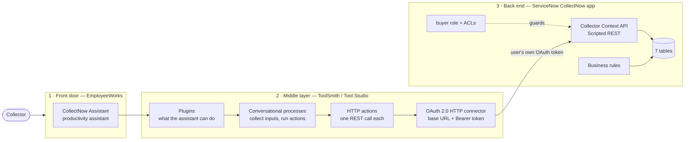
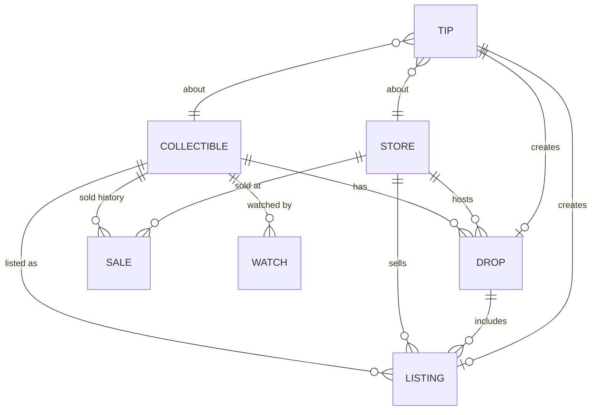

# Architecture and design intent

CollectNow was designed as a **three-layer build**:

- **EmployeeWorks** is the AI "front door."
- **ToolSmith (in Moveworks Tool Studio)** builds the middle layer that turns a conversation into API calls.
- **ServiceNow** is the system of record that holds the data and enforces the rules.

Part of the point was learning how these three layers fit together, so this doc records both what we built and what we learned.

---

## The three layers

**Runtime path:** collector → EmployeeWorks assistant → plugin → conversational process → HTTP action → OAuth connector → `/api/x_1234_team39_co_0/collector/...` → app logic and tables.

| Layer | Owns | Does *not* own |
|---|---|---|
| **EmployeeWorks (front door)** | Understanding the question, choosing a plugin, phrasing the answer, asking for confirmation before consequential actions | Business rules, data, permissions |
| **ToolSmith plugins (middle layer)** | Mapping intents ("find an upcoming drop", "check past prices") to specific API calls and their inputs | Computing answers or storing data |
| **ServiceNow (back end)** | Data, validation, derived values (deal signal, drop status), security | Conversation, wording |

The rule we followed: **the assistant asks, the middle layer routes, and ServiceNow decides.** Anything that must be correct every time, such as approval guard rails, deal math, status and access, lives in ServiceNow, where it's deterministic and testable with ATF. It doesn't live in a prompt.

---

## Why the data model looks like this

Each table exists to answer a question a collector actually asks the assistant.

| Collector asks… | Answered by | Table(s) |
|---|---|---|
| "When is the next drop, and where?" | Upcoming and live drops, soonest first | `drop` (+ `store`, `collectible`) |
| "Where can I buy it right now, and for how much?" | Current listings, cheapest in-stock first | `listing` |
| "Is this price fair?" | Average and last sold price → `deal_signal` | `sale` (+ `listing`) |
| "I heard a rumor that…" | Crowd-sourced, reviewer-verified intel | `tip` → creates `drop` / `listing` |
| "Tell me when it's under $75" | Per-collector watch list | `watch` |
| "What is this item, exactly?" | Catalog identity (series, edition) | `collectible`, `store` |

Design choices made with the AI front door in mind:

- **Separate facts from claims.** `drop` and `listing` hold verified facts, and `tip` holds unverified claims. The assistant can say "that's a rumor" because the data model draws the line. In the demo, it flagged the Nov 9 restock as a rumor on its own.
- **Human in the loop for crowd data.** A tip only becomes a drop or listing when a reviewer approves it. A business rule blocks the approval if the type, collectible, store or date is missing, and the message names the missing field.
- **Derived fields stay server-side.** `drop.status` (upcoming / live / past) is computed by a business rule, so every consumer gets the same answer.
- **Human-friendly numbers as IDs.** Every table is auto-numbered (COL, DRP, LST, TIP, SAL, WCH), and the API accepts a number *or* a sys_id. That makes the assistant's answers and follow-ups readable ("DRP0001008") instead of opaque GUIDs.
- **Multiple ways in.** Tips can come from an inbound email action as well as from the UI, so the intake channel stays flexible.

Field-level detail: [`servicenow/data-model/fields.csv`](../servicenow/data-model/fields.csv).

---

## The API is shaped for an AI caller

The Collector Context API ([`servicenow/server/rest-api/`](../servicenow/server/rest-api/)) is the contract between the middle layer and the back end. It's deliberately **context-shaped, not table-shaped**:

- **One call, the whole picture.** `GET /collectible/{id}` returns the item, previous sales, live and upcoming drops, current listings, and a computed `market` block. The plugin doesn't need to chain four table queries.
- **Conclusions, not just data.** `market.deal_signal` (`great_deal` / `fair` / `overpriced`) and `lowest_current_price` (sold-out listings excluded) are computed in ServiceNow. The LLM explains the verdict; it doesn't do the arithmetic.
- **Small, stable JSON.** It returns display values for stores and conditions, numbers as numbers, and predictable keys.
- **Clear errors.** It returns `400` for a missing input, `404` with the id that wasn't found, and `201` with the new record number on create, so the assistant can recover gracefully.
- **Identity comes from the token.** `POST /watch` always sets `watcher` to the calling user, and a read-own ACL limits `GET /watches` to the caller's own watches. The client never passes "who am I."

---

## Security: whose permissions apply?

The middle layer connects to ServiceNow with per-user OAuth. Each collector authorizes once, so **every API call runs as that person**, and ServiceNow enforces their roles and ACLs:

- The REST endpoint requires the `x_1234_team39_co_0.buyer` role (anonymous calls get 401).
- `buyer` can read the catalog tables, create watches, and read only their own watches.
- The client secret lives only in the Tool Studio connector, never in the app or this repo.

See [`servicenow/security/`](../servicenow/security/).

---

## The middle layer: ToolSmith plugins

ToolSmith builds plugins from a description of the outcome. It proposes a plan, generates the HTTP actions and conversational processes, and asks for connection details when it needs them. During the demo, the assistant's **AI Steps** showed it calling actions such as *"Look up CollectNowCollectible — Search By Text"* and *"collectnow_find_upcoming_drop…"*, followed by the context lookups.

| Plugin / capability | Backing API call | Starter prompt in EmployeeWorks |
|---|---|---|
| Find a collectible | `GET /collectibles?q=` | — |
| Find an upcoming drop | `GET /collectible/{id}` → `upcoming_drops` | "Find an upcoming drop" |
| Find the cheapest current listing | `GET /collectible/{id}` → `current_listings` | "Find the cheapest current listing" |
| Check past prices / deal check | `GET /collectible/{id}` → `market`, `previous_sales` | "Check past prices" |
| Watch an item *(confirm first)* | `POST /watch` | — |

> **Team: please confirm.** The plugin names above are inferred from the assistant's starter prompts and the AI Steps shown in the demo. Edit this table to match the plugins you actually built in Tool Studio.

---

## Lessons learned building the middle layer

- **Start narrow, end to end.** One capability working all the way from chat to ServiceNow and back beat five half-wired ones. Add plugins after the first path works.
- **Put the logic in the platform, not the plugin.** The more the API computed (deal signal, status, cheapest in-stock), the simpler and more reliable the plugins and answers became.
- **Design the API for the caller.** A single context endpoint with small, predictable JSON was much easier to wire into a plugin than raw table queries.
- **Do the auth plumbing early.** Connecting the middle layer to ServiceNow as the signed-in user took longer than building any single feature.
- **Test with real questions in the assistant.** Natural-language questions surfaced issues that clean API calls didn't, such as missing timezones and ambiguous rumor wording.
- **Keep guard rails deterministic.** Validation in business rules plus ATF tests on the negative paths means the assistant can't talk its way past a rule.

## Known gaps and next steps

- **Use `GlideRecordSecure` in the REST scripts.** The scripts use `GlideRecord` today. ACLs on the endpoint and the Watch table cover the demo, but row-level ACL enforcement inside the API is the safer pattern.
- **Recalculate drop status on a schedule.** Status recalculates only on save today.
- **Add price-alert notifications** when a watched item drops below `max_price`.
- **Lengthen the URL fields** that are capped at 30 characters (`store.website`, `listing.listing_url`, `tip.source_link`).
- **Load sales history** so `deal_signal` has data for every item. The demo dataset has few or no sales.
